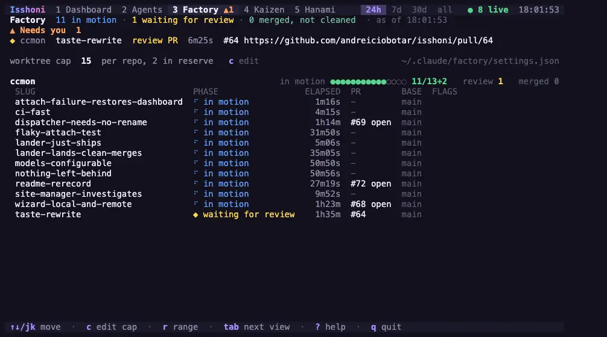
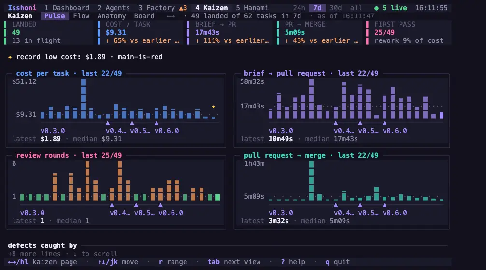

<p align="center">
  <picture>
    <source media="(prefers-color-scheme: dark)" srcset="assets/isshoni-dark.png">
    
  </picture>
</p>

<h1 align="center">Isshoni · 一緒に</h1>

<p align="center">
  <i>issho ni</i>, Japanese for "together"
</p>

<p align="center">
  A software factory for Claude Code that gets better with every task.<br>
  Give it a brief, get back a reviewed pull request, and see where every token went on a live terminal dashboard.
</p>

<p align="center">
  <a href="https://github.com/andreiciobotar/isshoni/actions/workflows/test.yml"></a>
</p>

<p align="center">
  
</p>

Isshoni is two tools for people who run [Claude Code](https://claude.com/claude-code) on their repositories. Each works without the other.

| | What it does | You run |
|---|---|---|
| **Monitor** | Shows where the money and tokens went: per repository, task, session, agent and model | `isshoni`, `isshoni-tui` |
| **Factory** | Orchestrates Claude Code agents: several tasks in parallel, each in its own git worktree, each ending in a reviewed pull request | `/factory:dispatch`, from the `factory` plugin |

## Setup

Needs `git`, Python 3.11+, [Go 1.27+](https://go.dev/dl) for the dashboard, and, for the factory, Claude Code and an authenticated [`gh`](https://cli.github.com), on macOS or Linux.

Monitor:

```sh
git clone https://github.com/andreiciobotar/isshoni && cd isshoni
bin/isshoni sessions --since 7d    # where the money went
make install && make up            # live dashboard; needs Go 1.27+
```

Factory: `make wizard` in the clone checks the tools, builds the dashboard, installs the plugin, writes the settings, offers cost alerts with the daily digest, offers GitHub's `gh stack` extension and offers the factory its own GitHub App ([what each step does](docs/factory.md#setup-and-uninstall)). Then, in Claude Code, in the repository you want work done in:

```
/factory:dispatch
```

The factory works on any GitHub repository and runs whatever tests that repository uses ([your own repository](docs/factory.md#using-it-on-your-own-repository)). Describe a task; ask for progress whenever you like. By default leads run unattended on Fable in `auto` permission mode, five tasks at a time per repository, one of them held for emergencies, each against a time limit set by its size (45 min, 90 min or 2 h) ([settings](docs/factory.md#settings)). Each role's model is set under `[models]` in `~/.claude/factory/settings.toml`.

Optional:

- [Always on](docs/container.md): `make wizard-remote` asks for what it needs and runs the factory in a container on a Linux host that has Docker. One SSH address shows the dashboard, and `d` there opens the dispatcher.

`make uninstall` removes what the wizard put on this machine, `make uninstall-remote` a server's install.

## The software factory

<p align="center">
  <picture>
    <source media="(max-width: 600px)" srcset="assets/diagrams/factory-narrow.svg">
    
  </picture>
</p>

Every task is two sessions: the lead (Fable) checks the brief, writes the spec, judges the build and hands it over, with explorers for its questions; the tech lead (Opus) builds from the spec with explorers, coders and reviewers, then tests and pushes the pull request ([Tech lead](docs/factory.md#tech-lead)).

A lead asks you only what it cannot decide itself; comment on its pull request and it answers or acts. The pull request is a draft until it is handed over, green and free of conflicts. Nothing merges without you: approve with a review (or a comment `lgtm`), and the lander, one script across every task, merges what you approved, in order.

What the lander finds conflicting or with a failed check goes back to the tech lead: it resolves it, notes it on the pull request and hands over again, waking the lead only if the resolution would change the behaviour asked for. A check that fails before hand-over is part of the build: nobody is messaged, the pull request stays a draft. A red main is the site manager's to report to the dispatcher.

Questions about a running system go to an ops explorer (Haiku), which reads logs and metrics through the read-only MCP tools you list on `ops.tools`; the lead and the tech lead send one when they need evidence ([Reading production](docs/factory.md#reading-production-the-ops-explorer)). An ops watch is the long-running form: only you start it, from your own terminal, `factory ops start <name> "<goal>" --every 10m --until 6h --budget 5`, and on each tick a fresh look sends ops explorers and tells you and the dispatcher of an alarm, a verdict or a spent budget ([Watching production](docs/factory.md#watching-production-the-ops-watch)). A watch has no worktree and talks to no task.

<p align="center">
  
</p>

## Kaizen (改善), built in

Most multi-agent setups run on day 100 the way they ran on day 1. Isshoni's factory is self-improving. On every task:

- Every agent reports what slowed it down.
- Every lead records the key calls it made without asking, and why.
- Every finished task leaves a retrospective and, in the monitor, its cost.
- Every site manager alert is marked acted-on or noise, so its precision and recall are measured.

A fresh session with the [review charter](factory/roles/kaizen-review.md) reviews it all every hour there was activity and files each proposal as an issue; you decide.

<p align="center">
  
</p>

On day one, agents reported the same shell friction eleven times and counting. It became a rule that day ([#8](https://github.com/andreiciobotar/isshoni/pull/8)).

## Monitor

`isshoni` reads the transcripts Claude Code already keeps in `~/.claude/projects` and never writes there. Beyond cost and tokens it shows the signs of wasted work: repeated dispatches, review loops, agents on a model other than the one pinned for them. Parsed sessions are cached outside that directory ([cache](docs/isshoni.md#cache)).

Cost is the API list price, from [isshoni/prices.toml](isshoni/prices.toml). `isshoni-tui` is the same data live, plus the factory's tasks and whether it is getting better. One more view, [Hanami (花見)](docs/isshoni.md#hanami-花見-the-work-as-something-to-watch), draws the work as motion: something to leave on a second screen.

<p align="center">
  
</p>

Every view, the Agents one too, and its keys: [docs/isshoni.md](docs/isshoni.md#dashboard-isshoni-tui).

## More

- [docs/factory.md](docs/factory.md): commands, states, settings, logs, the site manager
- [docs/isshoni.md](docs/isshoni.md): the monitor's options, the dashboard's keys and serving it over SSH
- [docs/shutdown.md](docs/shutdown.md): what ends each process and what each leaves behind
- [docs/flaky-tests.md](docs/flaky-tests.md): the rules that keep tests from failing at random, and every flaky job seen so far
- `make test` runs everything

## Status

Early and changing; built with itself. Source-available, not open source ([MIT with the Commons Clause](LICENSE)): use it, at work too, change it, [contribute](CONTRIBUTING.md). Don't sell it.
<!-- scratch: stack rebase experiment lease-a-amended-2 -->
<!-- scratch: stack rebase experiment lease-y1 -->
<!-- scratch: stack rebase experiment lease-y2 -->
<!-- scratch: stack rebase experiment lease-x1-amended-2 -->
