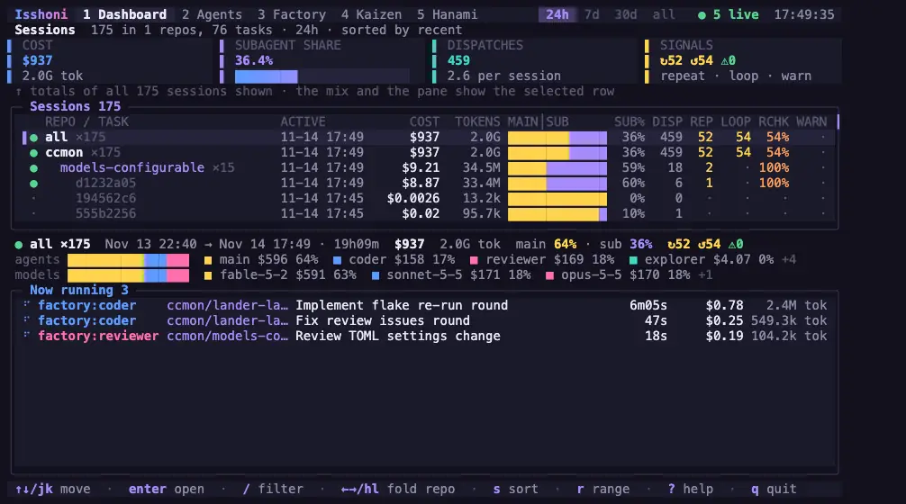
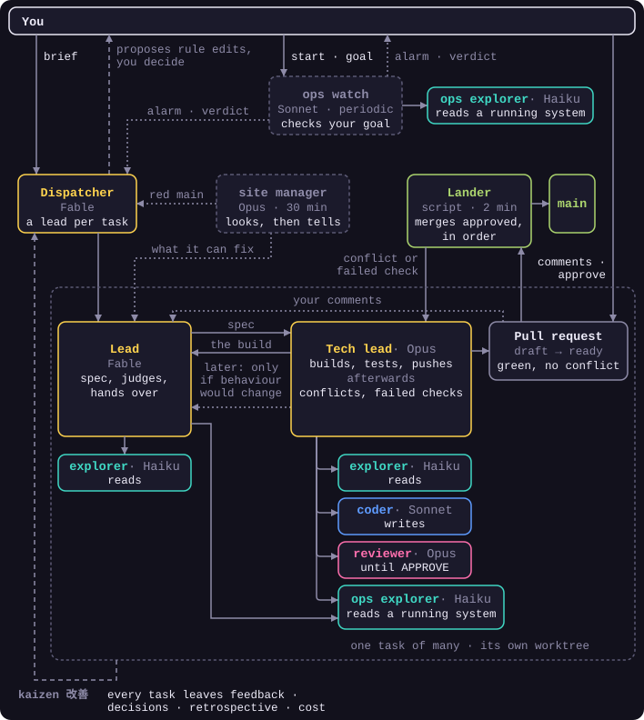

<p align="center">
  <picture>
    <source media="(prefers-color-scheme: dark)" srcset="assets/isshoni-dark.png">
    
  </picture>
</p>

<h1 align="center">Isshoni · 一緒に</h1>

<p align="center">
  <i>issho ni</i>, Japanese for "together"
</p>

<p align="center">
  A software factory for Claude Code that gets better with every task.<br>
  Give it a brief, get back a reviewed pull request, and see where every token went on a live terminal dashboard.
</p>

<p align="center">
  <a href="https://github.com/andreiciobotar/isshoni/actions/workflows/test.yml"></a>
</p>

<p align="center">
  
</p>

## Get started

Needs macOS or Linux, `git`, Python 3.11+, [Go 1.27+](https://go.dev/dl), [Claude Code](https://claude.com/claude-code) and an authenticated [`gh`](https://cli.github.com).

```sh
git clone https://github.com/andreiciobotar/isshoni && cd isshoni
make wizard    # checks the tools, builds the dashboard, installs the plugin, writes the settings
```

Then, in Claude Code, in a GitHub repository whose default branch requires a status check (the dispatcher offers `factory ci setup` when it does not):

```
/factory:dispatch
```

Describe a task. A reviewed pull request comes back.

- One repository only: `make wizard ARGS="--repository <path>"`
- Update: `make reinstall`. Remove: `make uninstall`.
- Always on, on a Linux host with Docker: `make wizard-remote` ([container](docs/container.md))
- The monitor alone: `bin/isshoni sessions --since 7d` prints where the money went; `make install && make up` opens the dashboard.

[Every setup step](docs/factory.md#setup-and-uninstall) · [your own repository](docs/factory.md#using-it-on-your-own-repository)

## How it works

<p align="center">
  <picture>
    <source media="(max-width: 600px)" srcset="assets/diagrams/factory-narrow.svg">
    
  </picture>
</p>

## Day to day

- **Hand it work.** Tell the dispatcher what you want. Each task gets its own worktree; five run at once per repository.
- **Watch.** Ask the dispatcher for progress, or run `make up`: the Factory view shows the pull request that waits for you, then every task.
- **Decide.** A lead asks only what it cannot decide itself; its question waits in the dashboard's Inbox, where you pick an option by number; the Inbox also lists the pull requests waiting for your approval and what was decided. Comment on its pull request and it answers or acts. Approve with a review or a comment `lgtm`; the lander merges approved pull requests in order. Nothing merges without you.
- **Improve.** Every task leaves feedback and a retrospective. A review reads them and files each proposal as an issue; you decide ([kaizen](docs/factory.md#kaizen-review)).
- **Production.** Tasks can read logs and metrics through read-only MCP tools you grant ([reading](docs/factory.md#reading-production-the-ops-explorer)); an ops watch checks a running system on a schedule ([watching](docs/factory.md#watching-production-the-ops-watch)).

<p align="center">
  
</p>

## Settings

`~/.claude/factory/settings.toml`. Every key has a default ([all of them](docs/factory.md#settings)).

| Key | Default | |
|---|---|---|
| `limits.worktree_cap` | 5 | tasks at once per repository, one held for emergencies |
| `limits.task_time_limit_hours` | 2 | a task's size sets its limit: 45 min, 90 min or 2 h |
| `[models]` | | each role's model |
| `sessions.lead_permission_mode` | `auto` | leads run unattended |
| `kaizen.review_hours` | 1 | the review's period; about 2 USD a run; `0` turns it off |
| `kaizen.issues_repo` | empty | owner/name where proposals are filed; empty files nothing |

## Monitor

`bin/isshoni` reads the transcripts Claude Code keeps in `~/.claude/projects` and never writes there. Cost is the API list price ([isshoni/prices.toml](isshoni/prices.toml)). It flags wasted work: repeated dispatches, review loops, agents off their pinned model. `make up` is the same data live ([options, views, keys](docs/isshoni.md)).

## More

- [docs/factory.md](docs/factory.md): commands, states, logs, merging, the site manager
- [docs/shutdown.md](docs/shutdown.md): what ends each process and what it leaves behind
- [docs/flaky-tests.md](docs/flaky-tests.md): the rules that keep tests from failing at random
- [CONTRIBUTING.md](CONTRIBUTING.md); `make test` runs everything

Early and changing. Source-available, not open source ([MIT with the Commons Clause](LICENSE)): use it, change it, don't sell it.
