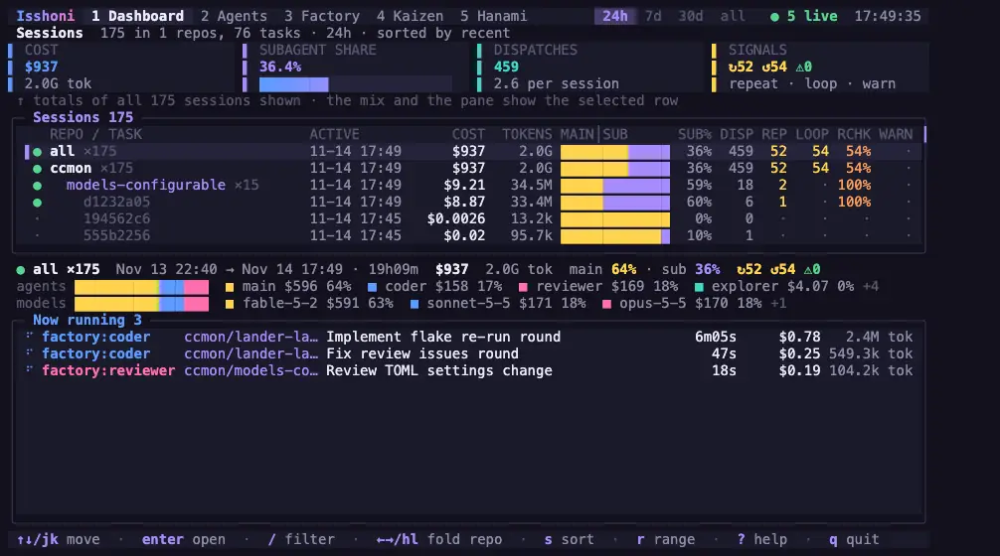
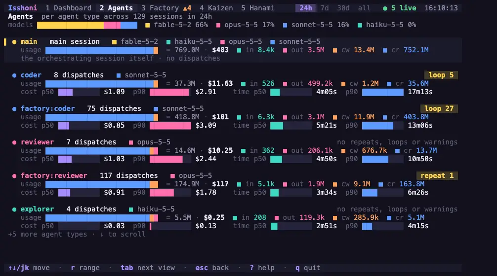
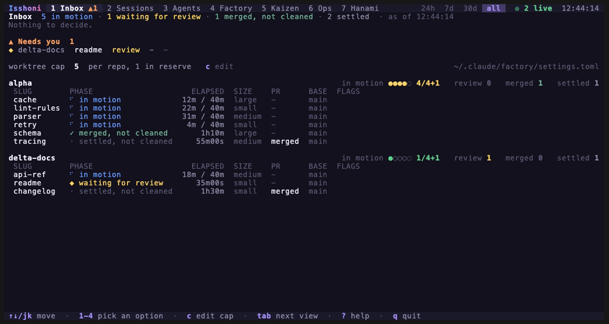
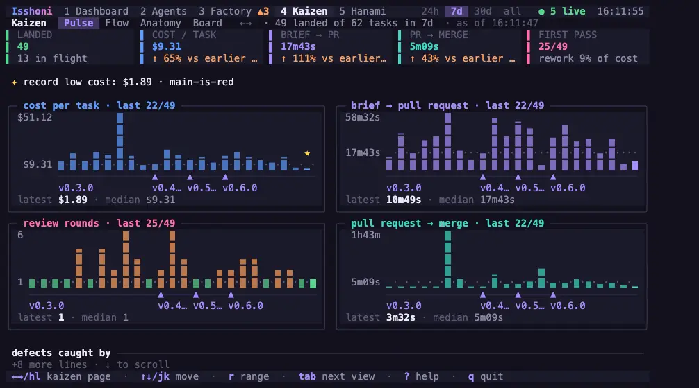
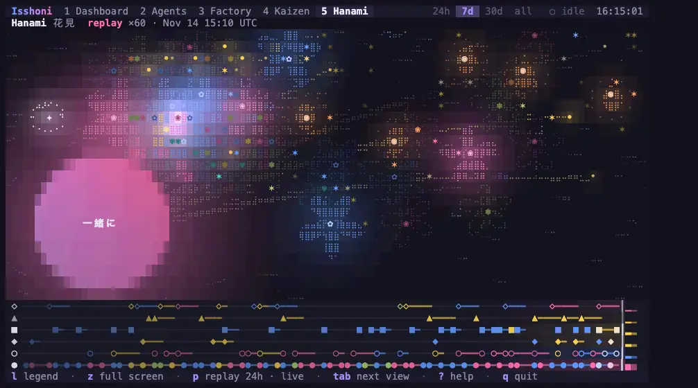

# isshoni reference

Read-only CLI over `~/.claude/projects` transcripts (Python 3.11+, stdlib only).
```
bin/isshoni sessions [--since 7d]     # sessions grouped by repository and task, with totals
bin/isshoni session <id-prefix>       # totals by model/agent, warnings, dispatch timeline
bin/isshoni agents [--since 7d]       # per agent type: tokens, p50/p90, repeats, WARN
bin/isshoni agents --repo isshoni --task ci-workflow   # tokens by agent and model for one task
bin/isshoni kaizen [--since 30d]      # the factory's improvement measures (see Kaizen measures)
bin/isshoni anatomy [--since 30d]     # per task and role: calls, contexts, cost by token class (see Cost anatomy)
```
`sessions`, `agents` and `anatomy` accept `--repo NAME` and `--task NAME` (exact match).
Global options: `--json` (one JSON document on stdout), `--projects-dir`,
`--agents-dir` (agent definitions used for the model WARN), `--prices` (price file), `--repeat-threshold`
(Jaccard, default 0.5). `--since` takes `Nd`, `Nh`, `Nw` or an ISO date.
Exit codes: 0 ok, 2 usage error (unknown or ambiguous session id, bad option).
Flags in the timeline: `repeat`, `review-loop`, `rechecked`, `WARN`, plus the
status when not `completed` (`running`, `no-run`, `orphan`).

Cost: every command shows money next to tokens, priced per message from
`isshoni/prices.toml` (per million tokens: input, output, cache write 5m and 1h, cache
read; an optional `long_prompt` table for a model that charges more above a prompt
size). Edit the file or pass `--prices PATH` (`isshoni-tui --prices` passes it on); a
missing or invalid file exits 2. A model id matches a table exactly or minus a trailing
`-YYYYMMDD`; nothing else is guessed, because a proxy's `provider/model` may bill
differently. A model with no table is never counted as zero: it shows as `unpriced`,
figures that contain its tokens end in `*`, and a footer names it. In `--json` every
usage object gains `cost` and `unpriced` (tokens), each session, task and repository a
`cost` block beside `tokens` (with `unpriced_tokens`, `unpriced_models`), agents
`cost_p50`/`cost_p90`, and each document a `prices` block. Your own prices: `$XDG_CONFIG_HOME/isshoni/prices.toml`, else
`~/.config/isshoni/prices.toml`, is read when `--prices` is absent and overlays the built-in
file: only `[models."<id>"]` tables are allowed, and an entry adds a model or replaces a
built-in one. A table is the five rates, or exactly `like = "<id>"`, which takes the whole
table of a model that has rates (not another `like`; valid in any price file). A missing
file is normal; an invalid one exits 2 naming the file and the entry. With `--prices PATH`
the file is read alone. The path is shown beside the built-in one (`prices:` footer, the
`prices` block as `user_path`, the dashboard help). `isshoni price MODEL --like ID` or
`isshoni price MODEL --input N --output N --cache-write-5m N --cache-write-1h N --cache-read N`
(non-negative, per million tokens in the built-in currency) writes one table into that file
and prints one line: the path, the id and the rates now in force (and the id it follows).
It validates before it writes, changes nothing on an error (exit 2) and rewrites the whole
file from its tables, keeping only the five rates, `long_prompt` and `like` (the first line says so). To remove a price,
delete its table. Limits: cost is the list
price at the file's `as_of` date, not what a subscription charges; fast mode, US-only
inference, web search and batch are not priced; it is a lower bound, because Claude
Code makes helper calls (web search and fetch summaries) that it does not write to the
transcript.

Grouping: a task is a git worktree a session worked in. A session belongs to one
repository and at most one task: the last worktree it entered (from the
`worktree-state` lines of its main transcript, ignoring `agent-<hex>` subagent
worktrees), else its first `cwd`; the repository is the path before
`/.claude/worktrees/`. A session that switched worktrees is counted whole under the
last one; its `worktrees` field lists every task it entered. In `--json` each session
gains `repo`, `repo_path`, `task`, `worktrees`, and `sessions --json` gains `repos`
(repository and task totals with the same keys as a session). Known limits: a session
started in a subdirectory of a repository, outside any worktree, shows that
subdirectory as its repository; review loops are detected inside one session, so a
task's count is the sum over its sessions.

Plugin agents: a plugin's agent is dispatched as `<plugin>:<name>` (`factory:coder`)
and counts as `<name>` for review loops, re-checks and repeats, and for its colour and
position in the dashboard. Its full name is shown, and it keeps its own row in `agents`
and its own `by_agent` key, apart from a bare `coder`. Its model is not checked by
default, because a transcript does not record where a plugin's definitions were loaded
from; pass `--agents-dir <plugin>/agents` to check it against `<name>.md` there (the option
replaces the default directories, so bare agents are checked against the same files).

For a resumed agent (`SendMessage`), duration covers dispatch to first return while
tokens include the resumed work. `running` means no completion (hand-back or
task-notification) was found in the transcript.

## Kaizen measures
```
isshoni kaizen [--since 7d] [--factory-dir DIR] [--json] [--cached] [--modes]
```
Whether the factory is getting better, computed once. It reads the factory's stores
(`--factory-dir`, default `~/.claude/factory`; format in `docs/factory.md`, "Logs"), the
transcripts and the price file; it never imports or runs `factory/bin/factory`. It writes
three things there: its caches, one file per repository each (`cache/kaizen-prs-<key>.json`, and the
pulse's `cache/kaizen-merges-<key>.json` and `cache/kaizen-approvals-<key>.json`, below) and, for a `gh` call that takes over 2 s or fails, one line in
`gh-YYYY-MM.jsonl` (the factory's debug log, which the factory prunes).
`--since` keeps the tasks that started at or after the cutoff (and the stops, slowed
texts and feedback of that range) and limits the transcripts loaded. Without `--json` it
prints the headline numbers, the pulse (a line naming today and the baseline, then four lines `today X (n=..), baseline Y (n=..): <verdict>`, below), one line per friction figure and one line per task. A missing or empty directory exits 0 with
empty lists (`store_found: false` when the directory is missing). Records are read with a
default for every field and lines that are not JSON objects are skipped.

A task is a `(repo, slug)` that appears in events, retros or the task state log; records without
a `slug` or a `repo` are skipped, and worktrees the monitor sees that the factory never
started are not tasks. **Landed** means the task's pull request is merged. Pull requests
come from a cache on disk per repository, matched on the head branch `worktree-<slug>`
(the newest when several). The cache is refreshed when it is older than 10 minutes, by
`gh api repos/{owner}/{repo}/pulls` run in the repository, most recently updated first,
100 a page, 10 s a page, stopping at what the cache already holds (at most 10 pages, so
1000 pull requests on a first fetch); repositories are refreshed at the same time. With
`--cached`, `gh` is never run. A refresh that fails keeps the cache: the tasks keep their
`pr`, `prs` stays `ok`, `prs_error` holds the reason and the text output says
`pull requests for <repo> as of <age> ago: <reason>`. Only when there is no cache at all
(`gh` missing, not a GitHub repository, no such path, bad output, or `--cached` before
any fetch: `not fetched yet`) does the repository's `prs` hold the reason; its tasks then
have no `pr`, and nothing there counts as landed.

The document: `generated`, `factory_dir`, `store_found`, `prices`, `roles` (the role
names in display order; every `by_role` and `share` object has exactly these keys), `repos`
(`repo`, `repo_path`, `prs`: `ok` or the reason, `prs_as_of`: when the pull request data
used was fetched, `prs_error`: why this run could not refresh it), `versions` (each plugin version by its
earliest record in any store), `tasks`, `summary`, `stops`, `slowed`, `rewards`, `outbox`,
`site_manager`, `tech_lead`, `pulse`, `friction`.
Times are UTC (`2026-11-14T00:01:02Z`), a task's durations whole seconds, medians floats
that may be fractional, money in the price file's currency, and a missing value is `null`.

Per task (listed by `started`, tasks without one first, then slug):

| Field | Definition |
|---|---|
| `repo`, `repo_path`, `slug` | `repo` is the last component of the path |
| `version` | of its `TaskStarted` event, else of its earliest record in any store |
| `started` | `TaskStarted` time, else the start of its earliest transcript session |
| `state` | its last declared state (the task state record with the newest `ts`) |
| `pr` | `{number, url, state, opened, merged}` |
| `landed` | `pr.merged` is set |
| `mode` | `single` or `team`, from its last `TaskStarted` event; `single` when the event has none (every task started since 2026-11-15 is `team`) |
| `brief_to_pr_s`, `pr_to_merge_s` | `pr.opened - started` (null when negative); `pr.merged - pr.opened` |
| `size` | `size` of its `TaskStarted` event (`small`, `medium`, `large`), as written; null when absent |
| `cost` | from its transcript sessions (same repository and worktree name): `{total, unpriced_tokens, by_role, rework}`; `by_role` has `lead` (the main session), `tech-lead` (the main session of a tech lead run: its id is the `session` of a `techlead` record), `coder`, `reviewer`, `explorer` (also `Explore`), `lander` and `other` |
| `cost.rework` | cost of coder and reviewer dispatches that started after the first reviewer dispatch returned. A lower bound: the lead's own rework is not separable |
| `cost.after_review` | cost of every call of the task's sessions (main threads and all dispatches, lead included) after the first reviewer dispatch returned; null without a review |
| `review_rounds` | reviewer dispatches that ran (not `no-run`); null without sessions |
| `first_pass` | `review_rounds == 1`; zero reviews is not first-pass |
| `stops`, `stopped_s` | its stops, and the sum of their `waited_s` |
| `defects` | counts by `caught_by` (`tests`, `reviewer`, `lead`, `ci`, `human`, `other`) from its newest retro |

`summary` covers landed tasks only, each figure over the tasks that have the value (`n`):
medians of `cost`, `brief_to_pr_s`, `pr_to_merge_s`, `review_rounds`; `first_pass`
(`yes` of `of`); `rework_share` (rework over cost); `by_role`; `time` (`building_s` is
`brief_to_pr_s` minus `stopped_s`, never below 0, plus `stopped_s` and `merge_wait_s`).
`tasks` counts all, `in_flight` those not landed and not `acknowledged`, `dismissed` or `closed`, and
`defects` sums every task's newest retro. `trend` is null below `trend_min` (10) landed
tasks; else the median of each measure over the latest half (`latest_n`) against the rest.

`pulse` is today against a baseline, four lead figures each, for the Pulse page and the text output. A
day is a calendar day in the time zone of the time the document is built for (the machine's zone
unless a caller gives one); a pull request counts on the day it merged (`pr.merged`). The baseline is
whole days, the range without today: from the local date of the `--since` cutoff (no later than
yesterday) to yesterday, so `24h` is yesterday, `7d` the 7 days before today and `30d` the 30 days
before. Without `--since` it starts on the local date of the earliest merged pull request (no later
than yesterday). It always has at least one day; a day with nothing merged counts, with 0 pull
requests. The figures take every task of the store's repositories, pooled, and `--since` only sets the
baseline (the transcripts are loaded back to its first midnight, and to the start of every task merged
since). Keys:
```json
{"queue_since": "2026-11-01T08:00:00Z",
 "today":    {"date": "2026-11-15", "to": "2026-11-15", "days": 1, "merged": 4, "cost": {}, "first_pass": {}, "handover": {}, "conflicts": {}},
 "baseline": {"date": "2026-11-08", "to": "2026-11-14", "days": 7, "merged": 80, "cost": {}, "first_pass": {}, "handover": {}, "conflicts": {}},
 "days":     [{"date": "2026-11-08", "to": "2026-11-08", "days": 1, "merged": 11, "cost": {}, "...": "one per date, oldest first, today last"}],
 "verdicts": {"cost": "better", "first_pass": "few", "approval_to_merge": null, "conflicts": "same"}}
```
`today`, `baseline` and each of `days` hold the same figures, computed by one function over a list of
dates: `date` and `to` (first and last date, equal for one day), `days`, `merged` (merged pull
requests) and the keys below. The baseline is pooled, not a mean of the days: its cost per merged
pull request is all its days' spend over all its pull requests, its durations are percentiles over
all its pull requests, its first pass is the sums. `days` has one entry per date, `baseline.days + 1`
in all. `queue_since` is when the `queue` log (`docs/factory.md`) starts, null without one.
`verdicts` says how today compares with the baseline on four lead figures: `cost` (cost per merged
pull request, n = merged), `first_pass` (all sizes, n = their `of`), `approval_to_merge` (the median,
n) and `conflicts` (per merged pull request, n = `prs`). Each is `null` when today or the baseline has
no value; `"few"` when either n is under 5 (`PULSE_MIN_N`); `"same"` when today is within 10% of the
baseline (both zero is same); else `"better"` or `"worse"`, a higher first pass being better and a
lower value on the others. From 100 columns the Pulse page shows the four lead figures as cards, each with its delta, its verdict colour (better green, worse orange, same and few grey), a strip with a cell or two for each day (today last, in the verdict's colour or the text colour) and one detail line, and a faint block under them with the figures the cards leave out; below 100 columns it shows a row for each figure and its detail. The text output prints the verdict. The lead duration
is approval to merge, the factory's part; the human's wait (`to_approval`, `to_merge`) is detail
and never judged. The text output prints the heading and the four lead figures, the approval to merge median in place of the old hand-over to merge p90 line. The keys:
- `cost` (`tasks`, `dispatcher`, `site_manager`, `unpriced_tokens`, `per_merged`): the all-in cost per
  merged pull request. Everything the factory spent on that day (every model call with a timestamp on
  it, in a task's sessions, and in the dispatcher's and site manager's sessions of the store's
  repositories; a person's own sessions are not counted) over the pull requests merged on it, so
  unfinished work is in it. `per_merged` is null (shown `-`) when none merged.
- `first_pass`: per stated `size` (`small`, `medium`, `large`; anything else or no size is `unstated`),
  the tasks merged on those dates with a known `first_pass`: `yes` of `of`. `-` means `of` is 0.
- `handover`: `to_merge`, the median and p90 (`p50_s`, `p90_s`, over `n` tasks; null and `-` when `n` is 0) of the merge
  time minus the task's first `handed-over` state record, for tasks handed over at or before the merge.
  Where an approval time is known and falls between the two, it is split into `to_approval` and
  `approval_to_merge` (median and p90, same `n`). The approval is the `approved_at` of the `queue` log's `merged`
  record (null there: no approval was required, the task is not in the split); a pull request with
  no `merged` record gets it from GitHub (`approvals_backfilled` counts those in the split): the
  newest `APPROVED` review, else the newest comment that is `lgtm` by a user that is not a bot, at or
  before the merge. The backfill does not check that the commenter had the permission to approve.
  `sent_back` counts the `queue` log's `sent-back` records of the day, `sent_back_unchanged` those whose
  next record for the same pull request has the same `head`. They are summed over the days that did not end
  before `queue_since` and null (`-`) when none did: they start with the `queue` log, nothing earlier is backfilled.
- `conflicts` (`prs`, `base_merges`, `conflicted`, `per_merged`, `error`): conflicted base merges per
  merged pull request, from git history in the repository's main checkout (`repo_path`). A pull
  request's merge commit is the first-parent commit of `refs/remotes/origin/HEAD` whose subject starts
  `Merge pull request #<number> `; a pull request merged another way, or not fetched yet, is not in
  `prs`. A base merge is a commit on its branch's first-parent line with two parents whose second
  parent is an ancestor of the branch's base; it is conflicted when `git show --remerge-diff` prints a
  `remerge CONFLICT` line. A lower bound: a branch rebased before merging leaves no base merge.
  `per_merged` is `conflicted` over `prs` (null when `prs` is 0); `error` is one line when git failed
  (that pull request is left out and not cached). Every git call has a 10 s timeout.

The pulse runs git and gh only for pull requests merged today or in the baseline that its caches do not
hold, once each: `cache/kaizen-merges-<key>.json` (merge commit to pull request number and base
merges with their conflicted files) and `cache/kaizen-approvals-<key>.json` (pull request number to
approval time, or null when none was found) never expire. A failed call is not cached; gh runs 8 at a
time. With `--cached` neither runs, and a pull request not in the caches is unknown.

`friction` is the Friction page, second screen of the dashboard. Unlike the pulse, every figure follows `--since`: it is
computed from the tasks kept by the cutoff, and from records and calls at or after it (the one exception: the Bash-call
counts of `refusals` cover whole runs, because the parser keeps counts, not times). `null` and `-` mean unknown, never 0.
- `dispatcher` (`calls`, `cost`, `per_call`, `context_median`, `unpriced_tokens`): the main-thread calls of the dispatcher
  sessions (the relay's memory is the main thread's context), their cost per call and the median context of a call
  (input, cache write and cache read tokens). Bad: over $0.15 per call, or over 400k median context.
- `rework` (`cost`, `task_cost`, `share`, `per_task_median`, `n`): the sum of `cost.after_review` over the tasks (no review: no
  rework) against their total cost, and the median per task over the `n` tasks that have a review. It includes the lead's own
  calls; `summary.rework_share` (coder and reviewer dispatches only) is shown beside it as "subagents only". Bad: over 1/3.
- `causes`: the defects of each task's newest retro by their `cause` (`spec`, `brief`, `conflict`, `scope`, `code`); no cause or
  another value is `unstated`. Bad: a cause over 1/3 of the stated defects (`unstated` is shown apart).
- `refusals` (`after_calls` = 3, `roles`): per role, the share of `Bash` tool calls whose result was refused, from the transcripts:
  `guard` (the worktree guard: the result starts `This session is isolated in the worktree ... Refusing to run it`) and
  `classifier` (starts `Permission for this action was denied by the Claude Code auto mode classifier`). `bash` counts the
  role's Bash calls over whole runs, the refusals those at or after the cutoff. `after_cost` is the cost of the next 3 calls of the
  run after each refusal, a call counted once. Roles: the task sessions (`lead`, `tech-lead`), their dispatches by role, and the
  dispatcher and site manager sessions with a call at or after the cutoff (`dispatcher`, `site_manager`, their dispatches by role; one with none adds nothing, not even its Bash calls); a role with no Bash call and no
  refusal is left out. The `PermissionDenied` events stay what they are: the `DENIED` stops. Bad: over 5% for a role.
- `wakeups` (`prompts`, `tasks`, `cost`, `per_prompt`): prompts from the session (`from` is `session`) to a task's lead after its
  first hand-over, the tasks with at least one, and the cost of the session's calls (main thread and dispatches) from each such
  prompt until the next prompt from the session or the human; prompts from a subagent or a notification continue the same work.
- `queue` (`since`, `merged`, `updated`, `rerun`, `sent_back`, `stopped`, `per_merged`): the `queue` log's attempts per pull request
  merged in the range: its `updated`, `rerun`, `sent-back` and `stopped` records up to the merge, over the merged pull requests
  (`land-*` steps are the lead's own landing and are not counted). `since` is the log's oldest record; the whole object is null
  without a log, never zeros.
- `held`: per task, at or after the cutoff, the queue's `sent_back` records (any kind), `TaskPaused` events (`paused`), and
  `TaskPrioritized` events (`prioritized`) with the sum of their `paused_minutes`. Tasks with all zero are left out. The pause
  records are written by another task (`pause-churning-tasks`) and may be absent; a missing or mistyped field is ignored.
- `late_conflicts` (`tasks`, `files`, `log_tasks`, `git_tasks`, `git_prs`): conflicts that reached the pull request late, from two
  sources shown side by side, never added: `log` counts the queue records at or after the cutoff that are a `sent-back` of kind
  `conflict` or a `land-conflict` (null without a log, like `log_tasks`); `git` is the backfill, the conflicted base merges of the kept tasks' pull
  requests that the pulse already looked up (the `kaizen-merges` cache; nothing here runs git, `git_prs` counts the pull requests
  found in it). The columns overlap in time (a conflict the log records later is a conflicted base merge in git) and the log misses
  merges made by hand, so a number is not the sum of its two columns. Rows are sorted by their larger count.

`summary.by_mode` compares tasks from before the team (`single`) with those since (`team`): different tasks on different days, so the rows are a hint, not a measurement. One row per (`mode`, `size`) with a landed task, sizes in
the order `small`, `medium`, `large`, `null` (no size stated on the task's `TaskStarted`), modes
`single` then `team`. A row has `n`, the medians `cost_median`, `lead_share_median` (the lead's
share of the lines written, 0 to 1), `lead_calls_median`, `handover_s_median` (`TaskStarted` to the
first `handed-over` state), `review_rounds_median`, and `build_runs_median` (`techlead` records of
kind `build` per task; null for `single`), plus `first_pass` (tasks of the `n`), `defects` (the
sums by `caught_by`) and `lead_wakeups` (prompts to the lead after
its first hand-over, summed). A median over tasks with no value is null. `defects` is null
when no task of the row has a retro, `cost_median` skips a task whose tokens are all unpriced,
`lead_calls_median` ignores tasks with no lead transcript,
`handover_s_median` ignores a hand-over earlier than `TaskStarted`, and a team task with no
`build` record counts 0 build runs. `isshoni kaizen --modes`
prints the rows as a table, `-` for null, after a line counting the landed tasks of each mode; the
`tech_lead` counts of the merge queue (`came_back` and the rest) leave out `build` records.

`summary.mix` is how the cost mix by role moves: `window` (the integer 5) and `points`,
one per landed task with a cost above zero, in start order, from the fifth such task on
(so `points` is empty below five). A point has the task's `slug` and `version` (a string
or null) and `share`: for each role, the median over the five tasks ending at that task
of the role's share of the task's cost (`by_role` over `total`), a float from 0 to 1.
The medians are taken per role, so a point's shares need not sum to 1. The window does
not restart at a plugin version: a change in the mix shows in full three tasks after it.
A role added to `ROLES` in `isshoni/kaizen.py` gets its own key everywhere; an agent
whose role is not listed there is counted under `other`.

`summary.anatomy` is what drives a task's cost, per role, from the transcript runs of the
same landed tasks with a cost above zero (the lead's own run and every dispatch's, each
dispatch under the same six `ROLES` as `cost.by_role`). Its keys: `window` (the integer 5,
the tasks behind each point), `min` (the integer 5, the landed tasks a version needs before
the dashboard compares it), `points` and `versions`. Every `roles` object below has one key per
name in `ROLES`, null for a role that did not run enough.

- `points`: one per landed task with a cost, in start order, from the fifth on (as in
  `mix`). A point has `slug`, `version` (a string or null) and `roles`: per role, null when it
  ran in fewer than 3 of the window's 5 tasks (`window // 2 + 1`), else `{calls, peak, tools}`,
  each the median over the window's tasks in which the role ran: model calls, peak
  context in tokens (the largest context of any call of a run, median over the role's runs
  in a task; a float or null) and own tool calls (an `Agent` dispatch is not a tool call here;
  it is counted in `dispatches`).
- `versions`: one per entry of the document's `versions`, same order, also a version with no
  landed task (`tasks` 0 and every role null). A version has `version`, `tasks` (its landed tasks
  with a cost) and `roles`: per role, null when it ran in none of them, else `n` (the tasks it
  ran in), then the medians over those tasks: `share` (of task cost, 0 to 1) and `cost`
  (the role's `cost.by_role`), `calls`, `peak` (a float or null), `tools`, `dispatches`,
  `tools_per_dispatch` (the median of tools over dispatches in the tasks with at least one
  dispatch; null when none), and `classes`: the share of the role's cost, summed over those
  tasks, in `input`, `output`, `cache_write` (5-minute and 1-hour writes together) and
  `cache_read`; they sum to 1, and `classes` is null when nothing was spent.
- `classes` come from the per-call prices of the runs (as `isshoni anatomy` prices them);
  `share` and `cost` from the task's `cost`, as the mix does. Tasks that did not land are in
  none of these figures.

Every task has `authoring`: who wrote its product code and tests, over `ROLES`, from the
`Edit` and `Write` calls of its runs (`written` of `isshoni anatomy`, below; only the kinds
`product` and `tests`). `lines` and `calls` are `{role: int}`, and `lead_share` is
`lines.lead` over the sum of `lines`, a float from 0 to 1, rounded to 6 places, or null when
nobody wrote one. Each entry of `summary.anatomy.points` and `summary.anatomy.versions` has an
`authoring` object over its tasks (the window's, the version's landed tasks with a cost):
`tasks` (int, tasks in which any role wrote a line), `lead_tasks` (int, those in which the lead
made a product or tests call), `lines` (`{role: int}`, summed) and `share` (`{role: float}`:
each role's part of the summed lines, rounded to 6 places; null when `tasks` is 0). The share
is pooled over the lines, not a median: most tasks have a lead share of zero, so a median
would say nothing.

`summary.overhead` is what the dispatcher and the site manager spent in the period, per task
landed in it: `dispatcher` and `site_manager` (cost in USD, floats), `sessions` (int, how many
sessions were counted), `unpriced_tokens` (int), `landed` (int, equal to `summary.landed`) and
`per_landed` (`(dispatcher + site_manager) / landed`, null when `landed` is 0). A session counts
when it has no task, its repository is the repository of at least one task of the document, and
either its name (the last `customTitle` or `agentName` record of its transcript) is
`dispatcher-<repository directory name>` (the dispatcher) or its first prompt starts with
`Job: watch. Repo: ` or `Job: digest. Repo: ` (a site manager run). Its cost is that of every call
of the session and of its dispatches whose time is at or after the `--since` cutoff (every call
without one; a call without a time counts only without one), priced as `isshoni anatomy` prices.
The measure is the cost in the period over the tasks landed in the period. Three approximations:
a task started before the period but served in it is not in the divisor; a task-less session
that is neither is not overhead; and a session counts whole when its last name is
`dispatcher-<folder>`, including what it did before it was given that name and the subagents
it dispatched itself.

`stops`, oldest first: a lead's `QUESTION`, `BLOCKED` or `OVERTIME` message (`waited_s`
runs to the next prompt from the human or the dispatcher in the same session, null while
unanswered; `why` is the event's `summary`, the first line of the message, or null on
events logged before the hook stored one) and a denied permission
(`DENIED`, `why` is `<tool>: <reason>`). `slowed` lists every `slowed` text of the retros,
newest first. `rewards` fire only on real records over landed tasks in merge order: the
last 3 or more all first-pass; a latest cost, or a latest brief-to-pull-request time, that
is strictly the lowest of at least 5 tasks (a tie is not a record). `outbox` folds
`feedback` as the factory does (the latest status line wins, with its `pr`), counts issues
and decisions by status, and groups open issues by the first keyword topic that matches
(`permissions`, `brief`, `rules`, `tools`, `review`, `time`, else `other`).

`site_manager` is the site manager's record over every repository, read from
the firing log (every month file) and counted as `factory firings` counts it
(`docs/factory.md`, "Site manager"; a record without a `repo` counts nowhere): `escalated` firings and of those `acted`, `ignored` and `no_outcome`;
`suppressed` firings; `paused` firings (a task the site manager paused: counted apart, outside precision and recall); `extended` firings (a task whose limit the site manager extended: counted apart too; an extension decided before the limit counted from the decision, a record without `from`, is left out) and of those `kept` (handed over within the extension) and `overran` (not); a decision this version does not know counts nowhere; `missed` problems (`missed_suppressed` had fired and were
suppressed, `missed_never_fired` the rest); `precision` is `acted / (acted + ignored)` and
`recall` is `acted / (acted + missed)`, each 0 to 1, or null with nothing to divide by.
With `--since` it counts the firings that fired, and the misses recorded, at or after the
cutoff. Without a log every count is 0 and both ratios are null. The factory keeps
escalated firings and misses forever, so the two ratios are all-time; `suppressed` covers
what the log still holds (about a year).

`tech_lead` is what came back from the merge queue, read from the `techlead` log (every
month file; one record per come-back, `docs/factory.md`, "Tech lead"), the records at or
after the `--since` cutoff: `came_back` and of those `resolved`, `escalated`, `stopped` and
`unstarted` (went to the lead without a run); `cost` the sum of `cost_usd` over the records
that have one and `cost_resolved` the same over the resolved ones, each null when no record
has one (unpriced, never 0); `landed` the landed tasks of the document; `lead_wakeups` over
those tasks the `events` of event `UserPromptSubmit`, role `lead`, from `session` or `human`,
after the task's first `handed-over` record. Without a log every count is 0 and both costs
are null.

Limits: no landed figure without `gh`; a stop logged before the hook stored a summary has no reason;
the site manager's firings are counted, not listed (`factory firings` lists a
repository's); rework counts subagent runs only; costs are the list
prices of `isshoni/prices.toml` (see Cost above).

## Cost anatomy
```
isshoni anatomy [--since 7d] [--repo NAME] [--task NAME] [--factory-dir DIR] [--json]
```
Where a task's money goes, per role, from the same transcripts and prices as `sessions`.
A task is what `sessions` calls one: the sessions sharing `(repo_path, task)`; sessions
without a task are left out. A role is `lead` for a session's own transcript, and for a
subagent run the name of its agent type without the plugin prefix (`factory:lander` is
`lander`). `--factory-dir` (default `~/.claude/factory`) is read only for each task's plugin
version. Without `--json` it prints one row per task and role (`task`, `version`, `role`, `runs`,
`calls`, `ctx first`, `ctx median`, `ctx max`, `cost`, the shares of the role's cost by token
class `in%` `out%` `cw%` `cr%`, own `tools`, `disp`atches, `written`: the kinds with calls, as
`kind calls/lines`), a line counting the written calls that matched no kind, and the prices footer; no tasks prints `no tasks`.

`--json` is `{generated, factory_dir, prices, tasks, versions, unmatched}`; no tasks gives empty lists.
Each task has `repo`, `repo_path`, `task`, `version`, `start`, `end`, `cost` (the sum of its
roles' `cost.total`), `unpriced_tokens` and `roles`, a map from role name to a block that
aggregates the role's runs (one run = one transcript):

| field | meaning |
|---|---|
| `runs`, `models`, `calls` | transcripts of the role, the models seen, model calls (each message once; `<synthetic>` excluded: exactly what is priced) |
| `context` | `first` and `peak`: median over runs of a run's first and largest call context; `median`: over all calls; `max`: largest of any call. A call's context is `input + cache write + cache read`. Null when there are no calls |
| `tokens` | exact sums of `input`, `output`, `thinking` (part of `output`, not added to it), `cache_write_5m`, `cache_write_1h`, `cache_read` |
| `cost` | `total` and the five classes, rounded to 6 places. Over a task the roles' `total`s add up to the task's `cost.total` in `sessions --json` (to 1e-6) |
| `tools` | the role's own tool calls by kind, each tool call once, `Agent` excluded. `Bash` is split as `Bash:<command>` by the basename of the first word after an optional `cd <path> &&` |
| `written` | the role's own `Edit` and `Write` calls by kind of file: `{kind: {calls, lines}}`, all seven kinds always present, see below |
| `dispatches` | the role's `Agent` calls |
| `fill` | where the context came from, see below |

`version` is the plugin version of the earliest record of the task (same repository and slug) in the
factory's `events`, `retros` and `tasks` logs that carries one; null without one or without a store.
`versions` rolls the tasks up by version (null last): `version`, `tasks`, `cost`, `unpriced_tokens` and
`roles`, the role blocks computed over all runs of that version's tasks, not an average of task blocks.

**Written.** `written` says who wrote what, not what survived. Each own `Edit` and `Write` call (a fork's
copy of its parent's message is not counted twice) adds one call and some lines to the kind of its
`file_path` (a missing or non-string path is the path `""`). Lines are what a diff would count: for
`Write` the lines of `content`; for `Edit` the lines of `new_string` that are not in `old_string`
(a multiset difference, so the context an `Edit` repeats is not counted; `replace_all` counts once).
The kind comes from `isshoni/authoring.py`, the one place the rules live. A path is first cut after
`/.claude/worktrees/<name>/` when it has that part (it is then inside, and relative); the first
matching rule wins:

| kind | applies | the path |
|---|---|---|
| `scratch` | outside | ends in `.retro.json`; has a directory named `tmp`, `scratchpad` or `T`; contains `/.claude/jobs/` or `/.claude/plans/`; starts with `/private/var/` or `/var/folders/` |
| `spec` | outside | contains `/factory/specs/`, or ends in `.pr.md` |
| `rules` | inside | is `CLAUDE.md` or `AGENTS.md`; has a directory named `agents`, `skills`, `roles` or `commands` |
| `tests` | inside | ends in `_test.go` or `.golden`; is `test_*.py`; has a directory named `test`, `tests`, `testdata` or `fixtures` |
| `docs` | inside | ends in `.md` or `.txt` |
| `product` | inside | anything else in the worktree (code, config, data, assets): there is no list of extensions to fall behind |
| `other` | | everything else: a file outside `.claude/worktrees/` that is not scratch or spec (memory files, the main checkout, a worktree a hook made elsewhere), no path |

`unmatched` lists every path counted as `other` over the tasks of the document, `{path, calls, lines}`,
most calls first then by path; none is dropped, so a missing rule shows here. The headline kinds are
`product` and `tests` (`CODE` in `isshoni/authoring.py`).

Two limits, stated plainly. A write made through a shell command (`sed`, a heredoc, a generator,
`go test -update`) is not seen. And what was written is not what survived to the merge: a later edit by
any role overwrites it, and comparing with the merged diff would mean attributing each surviving line to a
tool call, which is neither cheap nor exact, so it is not done.

**Fill.** Per run, `base` is the first call's context. For each later call the context grew by
`delta`: `own_output` is the previous call's output (at most `delta`), the rest is `inbound`,
what arrived in between. A shrinking context counts one in `compactions` and adds nothing else.
`base`, `own_output`, `inbound` and `compactions` are exact. Only `inbound_estimate` is an estimate:
`inbound` split by character share among the sources recorded since the previous call,
`result:<tool>` (`result:?` when the tool is unknown), `message`, `attachment:<type>` and `handback`
(Agent results, `<task-notification>` texts); with no characters recorded it is all `unaccounted`.
The shares are rounded, so they need not sum to `inbound`.

Limits: images count no characters; a compacted run's fill is partial (the characters that arrived before the shrinking call are dropped); a reused slug adds up
into one task; the version is the first one logged, not the one running.

## Dashboard (`isshoni-tui`)

`make up` builds and runs it. It shows what `isshoni --json` reports, re-reading a
session when its transcript changes (checked every second for new or deleted sessions
and for sessions written in the last 10 minutes; older ones every 10 seconds). The
only file it writes under `~/.claude` is the factory's settings, when you save the
cap. It finds the Python package from `ISSHONI_ROOT`, else from the binary's own
location. It needs a terminal of at least 60x16.

The pictures here and in the README are recordings of this repository's own factory (`make pictures`, below), except the Factory floor, which `sh tools/floor.sh` records over the stub factory in `tests/fixtures/floor-root` with the invented repositories `alpha` and `delta-docs`; the checkout is in a directory named `ccmon`, which is why that name shows as the repository.









```
bin/isshoni-tui [--range 24h|7d|30d|all] [--follow] [--no-color]
                [--projects-dir DIR] [--agents-dir DIR] [--prices PATH]
bin/isshoni-tui --snapshot dashboard|inbox|session|agents|factory|ops|kaizen|kaizen-friction|kaizen-flow|kaizen-anatomy|kaizen-board|hanami|help [--size 140x40] [--session ID] [--row N] [--fold] [--frames N]
```
`--range` defaults to `7d`. `NO_COLOR` gives the plain rendering too. `--snapshot`
prints one settled frame and exits, non-zero when the load fails; `--row N` puts the
dashboard cursor on table row N (0 is the `all` row) and `--fold` collapses the
repository that row is in; `--frames N` prints N dashboard frames from one load,
separated by a form-feed line, frame i with the cursor on row `--row`+i (so the rows
keep one order across the frames); `--snapshot session` is the full-screen session (the
dashboard's zoom, below) of `--session ID`, else of the most recent one; `make screenshot
VIEW=... SIZE=...` turns it into a PNG under `shots/` (needs Chrome). Both make targets
take `FIXTURE=<name>` (a directory of `tests/fixtures`, e.g. `grouping`): they render a copy
of it with every file at 2026-01-01T10:30:00Z, as the golden tests do, with the fixture agents
and prices, `--range all` and times in UTC, so `--row N` is the golden test's row N.
`--snapshot ops` and the Ops tab need no fixture of that kind, only a root whose `factory/bin/factory` prints watches: `ISSHONI_ROOT=$PWD/tests/fixtures/ops-root` is one, with invented watches whose times are relative to now and no sessions, so `make screenshot VIEW=ops SIZE=100x30 ISSHONI_ROOT=$PWD/tests/fixtures/ops-root ARGS="--projects-dir tests/fixtures/ops-root"` renders the tab without reading your ops store.

| Key | |
|---|---|
| `tab` `shift+tab`, `1` `2` `3` `4` `5` `6` `7` | switch view: inbox, sessions, agents, factory, kaizen, ops, hanami |
| `1`-`4` | inbox, with a decision under the cursor: pick that option of it, then `enter` does the marked one of `Accept` `Reject`; `←` `→` `h` `l` `tab` switch the mark, `y` accepts, `n` or `esc` rejects. Every other key but `ctrl+c` is ignored until then. A digit the card has no option for switches the view as everywhere |
| `L` `S` | inbox, with a decision under the cursor: leave it to the lead (`L`) or to the site manager (`S`). The same confirm as for a digit, reading `Leave it to the lead?` or `Leave it to the site manager?`; `Accept` runs `factory decision answer <id> lead` or `site-manager`. In the confirm a digit, `L` or `S` changes the choice. Capitals: `l` and `s` keep their other uses. Nothing on a decision that is with the site manager |
| `↑` `↓` `j` `k`, `g` `G`, `pgup` `pgdn` | move, first and last, page |
| `←` `→` `h` `l` | dashboard: collapse the repository the cursor is in (the cursor moves to its row), expand it. A collapsed row (`▸`) keeps its totals, and the tiles and follow mode still count what is inside; a filter leaves it collapsed, counting the matches. Folding turns follow mode off and is forgotten on exit. On a short-runs row, `→` opens it and `←` closes it (also from one of its sessions); on a closed one `←` still folds the repository |
| `enter`, `esc` | dashboard: open the session row under the cursor full screen (the zoom; in it `↑` `↓` `g` `G` `pgup` `pgdn` move over the dispatches and `enter` swaps the list for the selected dispatch); on `all`, a repository or a task, a message says to pick a session row and the cursor stays. Back: first the detail, then the zoom, then the Inbox from any other view but the dashboard |
| `r` | range: 24h, 7d, 30d, all (on the error screen: retry) |
| `s` | sort: recent, cost, subagent share; within a repository, tasks and sessions without a task are one list; also puts the held order right |
| `/` | dashboard: filter by `repo`, `repo/task`, project or session id. Factory view: a dropdown to show `all` repositories or one (`↑` `↓`, `enter` chooses, `esc` closes) |
| `f` | follow the most recently active session (off until pressed or `--follow`; any cursor key turns it off) |
| `←` `→`, `h` `l` | kaizen view: previous and next page (Pulse, Flow, Anatomy, Board) |
| `c` | Inbox: edit the cap (digits or `↑` `↓`, `enter` saves, `esc` cancels) |
| `H` | inbox: toggle the History between the last day's first 8 entries and every entry the status carries |
| `d` | over SSH with a `write` key only: open the dispatcher's conversation on this connection ([Over SSH](#over-ssh)) |
| `?`, `q` | help, quit |

- **Inbox:** the start view. Under the sub-header, the open decisions of every repository as a mail inbox in two panes (the list is the `bubbles` table, which owns the cursor) with a vertical rule between them. Left, about 40% of the width and at least 30 columns: one row per decision under a faint header, `alpha  ? demo-task  Ship the importer…  12m` (the columns `REPO`, an icon, `TASK`, `ASK`, `AGE`), the icon `▲` in the warning colour for a `blocked` decision and `?` for a `question`, the repository's name written on the first row of its group only (repositories by their oldest decision, each one's decisions oldest first, then its approvals; `esc` or `backspace` in any other view comes back here, not to Sessions); the cursor row is marked `▌` and highlighted like the Sessions table's, its icon losing its colour. A decision parked with the site manager has its row dim with `…` for the icon. The list shows up to eight rows and then scrolls inside itself, so the message stays on the page. Right: the message of the cursor decision, its title (the task, the kind, `asked 12m ago`), a faint line from the task's status row (repository, how long it has been blocked or running, pull request, base: whatever the row has), the ask, and its numbered options, the one the lead recommends marked `(recommended)`, then a faint line `L leave it to the lead · S to the site manager`; below 110 columns the ask column of the list narrows first. A lead posts a decision with `factory decision ask` when its task waits on you ([factory.md](factory.md#messages)); without one, and with no pull request waiting for your approval, the page says `Nothing to decide.`. A pull request waiting for your approval is a message too: `alpha  ◆ demo-export  new #12  25m` (the icon `◆` in the colour of `review PR` in the band, the task, `new` when nobody approved it or `stale` when its head changed after the approval, the number, how long it has waited), after its repository's decisions, oldest first; a repository with only approvals still has its group. The right pane shows its title (`demo-export · approve · handed over 25m ago`, or `approval stale 2h ago`, then ` · as of 14m` when the factory computed the list more than 10 minutes ago, ` · as of unknown` when it gave no time), the task's status line, `New: handed over, checks green.` or the lander's reason for `stale`, the link whole (wrapped, never cut) and `Approve on GitHub: an approving review, or a comment reading lgtm.`. No key acts on that row: approving happens on GitHub, a digit switches tabs as everywhere, `enter` does nothing, `L` and `S` do nothing there either (an approval is never parked), and the footer offers no pick or leave there. `↑` `↓` `j` `k` move the cursor over the messages (the table's own paging keys are not bound), then, past the last row, scroll the page. A digit picks that option, `L` leaves it to the lead and `S` to the site manager (see the key table; the footer names the range of the cursor decision's options, `1–3`; the cursor stays on its decision when the factory is read again): the option is highlighted and `Accept   Reject` appears under the options; `Accept` runs `factory decision answer <id> <n>` in the decision's repository (10 s limit, never on the update loop), which queues the pick for the lead, and the next watch tick delivers it. `L` and `S` open the same confirm with the question `Leave it to the lead?` / `Leave it to the site manager?` under the options in place of the hint, and `Accept` runs the script with `lead` or `site-manager`. A decision left to the site manager stays in the list, parked: on the right `With the site manager since <HH:MM>` in place of the options and the hint; no key answers it, and it is not counted in the tab badge or repeated in the band; the task stays blocked on you meanwhile. A decision the site manager could not decide is back as a normal message with the line `The site manager handed it back: <reason>` under the ask, in the warning colour, its list row unchanged. The message shows `sending…` meanwhile; on success a toast says `answered <task>: <n>` (or `lead`, `site-manager`) and the factory is read again, so the decision goes when the status says so; on failure a toast gives the script's line and the decision is back to unpicked. A key that is not `write` over `--serve` gets the toast `read-only: this key may not answer a decision` and picks nothing (`L` and `S` too). Under the panes is **History**, one table across repositories (TIME, REPO when more than one repository has entries, TASK, BY, WHAT; no row is marked), what was decided and by whom, newest first (`10:42  demo-task  site manager  extended 20 min to 11:05Z: landing left`), from the answered decisions (the human's, or the site manager's for one left to it), the site manager's extensions, pauses and closes, the leads' key decisions and the hand-overs (the last 7 days, at most 100 entries, from `factory status --json`). By default the entries under 24 hours old, at most 8, then `… N older · H shows them`; `H` shows every entry. Times are local, with the date (`Nov 19 10:42`) for an entry from before today (in a narrow window the time alone); a long line is cut with `…`; with no entry there is no table. Then comes the factory table (the Factory tab's page before the floor): the band of what waits on you (without the tasks that have a decision, nor the `review PR` of a pull request shown as an approve row), the cap line (`c` edits it), and each repository's tasks. The cap, the table, the refresh (105 s while shown, 2 minutes otherwise, a fresh one on entering) and the scroll are the Inbox's alone. A decision can appear up to one refresh late, and `--snapshot inbox` shows it once. The `▲N` badge of what waits on you is on the `1 Inbox` tab (below 110 columns the tab is an envelope, `1 ✉`).
  The table, for each repository seen in the range that has task worktrees, what
  `factory status --json` reports: the tasks holding a slot against the cap (the meter
  shows the ordinary limit plus the slots held in reserve for critical work, `7/9+1`),
  and every task with its phase, elapsed time (for a task in motion, against its limit,
  yellow when nearing it and red past it; a task the site manager gave more time has one
  faint line beneath: `limit +30m by site-manager · <reason>`), size (shown when any task
  has one), pull
  request or deliverable, base, and `overtime` or `stale`. At the top, a band lists everything that waits on you across
  repositories, oldest first: tasks in review (the pull request or deliverable to look
  at) and tasks blocked on you (what they asked; a task blocked on the dispatcher or on
  another task says so in its row, with its reason beneath, and is not in the band), each
  with how long it has waited; when nothing waits it says so. A task the site manager paused reads
  `paused 12m: waits a, b` in place of `blocked on a, b`, yellow from 30 minutes on (a
  stale pause); a task the queue prioritizes reads `motion · prioritized 3m` (or
  `review · …`, or `blocked · …` for a released task still declared paused) in the phase
  column. A task whose work is over but which cleanup keeps shows a `kept` pill and the
  faint line `kept: uncommitted changes`; a task the site manager decided to leave as it
  is shows a `held` pill (`escalated` when it passed the call on) and the line
  `held 9h · <criterion> · <reason>`. Its line replaces the other detail line, and the row is
  never shown as overtime: its elapsed time is not red or yellow and it has no
  `overtime` pill. `c` sets `limits.worktree_cap` (1 to
  999) in `~/.claude/factory/settings.toml` by running `factory settings set`, which
  leaves every other byte of the file as it was (`<checkout>/factory/bin/factory`, found from the dashboard's own location; it needs no `PATH`). See [factory.md](factory.md).
- **Sessions** (the Dashboard tab before the Inbox): one screen, from the top: the totals for the range, the sessions as a
  tree of repository, task and session (with the agent and model mix beside it from 120
  columns), a pane about the row under the cursor, and every dispatch running now.
  A group row sums its sessions (rates from summed counts, never a mean of rates); a
  group of one session is a single row. A **short run** is a finished session (not live)
  under a minute long and under $0.25; two or more in one task, or two or more of a
  repository's sessions without a task, fold into one `N short runs` row after the rest
  of that task or repository (one alone stays a session row). The row is closed (`▸`) and
  opens one step deeper with `→`; it sums its sessions, and short runs count in every
  total, tile and `×N` as before. The cursor starts on the top row, `all`, which
  sums every session shown, and moves over every row. The tiles always total every
  session shown, and a line under them says so; under 30 rows one line stands for the
  tiles and that line. In the mix a plugin's agent counts with its role
  (`factory:coder` as `coder`); the Agents view keeps them apart. Columns: time (last
  activity when sorted by recent, else start), `COST`, `TOKENS`, `MAIN│SUB` and `SUB%`
  (shares of cost), `DISP` (dispatches), `REP` (repeats), `LOOP` (review loops), `RCHK`
  (re-checks), `WARN` (model warnings), `BAD` (malformed lines, only when there are
  any). A narrow terminal drops `BAD`, `SUB%`, `TOKENS`, then the time.
  The rows under the tree are split by the terminal's size alone, never by the cursor's
  row, so nothing moves as the cursor walks: the tree takes what it needs and the pane
  the rest (with fewer than 4 rows left over there is no pane content: the tree keeps them). The **pane header** is one line
  about the cursor row of any kind: live dot, the row, the repository and task of a
  session, its span, cost, tokens, the main and subagent shares and the repeat, loop and
  warning counts; fields drop from the right when the width is short. Every mix (the agent
  and model boxes, titled `Agent tokens` and `Model tokens` from 120 columns; the strips;
  the Agents view's models strip; the Session view's agent bar) takes share, bar length and
  model order from usage: tokens without cache reads (input, output, cache write), priced or
  not. Beside each share is an amount: dollars (`*` when some of the row's tokens
  are unpriced), or the row's token count when none of it is priced, never `$0`. A strip (under 120 columns, below the pane
  header) ends in `+N` when N entries do not fit. On a session row the pane shows its
  **Timeline** (when there is room for its lanes) above its **Dispatches**, none
  selected; the dispatches load a moment after the cursor rests on the row (the pane
  says so meanwhile), the list starts at its first dispatch, and a list cut short says
  how many there are in its title: `enter` shows them all. A group row has no pane
  content: **Now running** grows into the room. Now running is always there, in full
  width: every running dispatch of every live session, whatever the cursor is on (on a
  session row up to 2 lines in a terminal under 35 rows, 4 under 45, else 8; the last
  line is `+N more running` when cut).
  **Zoom:** `enter` on a session row shows it full screen: cost by agent, the timeline
  with a lane per agent type (dispatches of one type that overlap stack on extra rows),
  the dispatch list and the selected dispatch in detail. Idle stretches of the timeline
  collapse to a marker labelled with their length. A dispatch still `running` in a
  session that is no longer live is labelled `unfinished`. `esc` returns.
  **The cursor moves only when a key is pressed**, with one exception, follow mode
  (`f`, `--follow`; off by default, `following` in the sub-header and `● follow` in the
  footer), which any cursor key turns off. While the cursor is on a row other than `all`
  the order of the tree is held (the sub-header says `sorted by recent, held`): a
  refresh does not make rows trade places; `s`, `r`, or returning to `all` puts it
  right. The COST and time columns always show live values. A cursor row that
  disappears (filtered out, merged away) hands the cursor to the row now at the same
  table index and ends the zoom. Two limits: a session that appears above the cursor's
  row pushes the rows below it down a line, and a row that gains a second session splits
  into a group and a child row, a line or two lower; the cursor stays on its session.
- **Agents:** per agent type: dispatches, models, tokens and cost, p50/p90 cost and
  durations, repeats, review loops, warnings.
- **Factory:** a top view of a factory floor, drawn in horizontal and vertical strokes and
  filled cells, from what `factory status --json` reports for each repository seen in the
  range that has task worktrees. One conveyor snakes down the body in five lanes, each as
  wide as the window: `BLOCKED`, a siding with dashed edges that stands off the line, then
  `BUILD` flowing right, `REVIEW` left, `MERGE` right and `SHIPPED` left, which ends in a
  dock at the left edge. A solid junction block at the end of a lane is the gate into the
  next, in the colour of the lane it leads into (blue for BUILD, yellow for REVIEW, the
  muted green of merged, grey for SHIPPED, orange for BLOCKED); a small one is where the
  siding leaves BUILD, and an open mouth at the left of BUILD is where new tasks come in.
  A head tile at the left of each lane, in the same colour, gives its name and how many
  tasks it holds (`BUILD 3`), and `· N more` for the tasks that have no room. A junction
  and a head tile are bright when their lane holds a working session or a task that waits
  on you, and the same hue dimmed when the lane is idle or empty. Every task is a crate, a
  tile tinted with its phase colour, `▐▲ slug  elapsed▌`: its first cell is the mark
  (the spinner in green while its session works, `▲` in yellow when it waits on you, a
  ready pull request in review or a task blocked on the human, `!` in red when it is past
  its time, else a space), then the slug with the repository name before it when several
  repositories have tasks, and the elapsed time. A blocked crate adds what it waits on,
  and one whose phase the view does not know shows the raw phase there. A crate is as wide
  as its text up to about 24 cells (16 at 80 columns); the slug is cut with `…` and the
  elapsed time dropped first. Crates queue from the head tile of the lane of their phase:
  in motion in BUILD, in review in REVIEW, merged (not cleaned up) in MERGE, settled in
  SHIPPED, blocked or unknown in BLOCKED. Position is an order, not a measurement: BUILD
  crates stand by elapsed time against the limit (furthest along first, tasks without both
  last), the other lanes by slug. A taller window gives the lanes more rows; a lane of 3 or
  more inner rows has 3-row crates. Flow marks, `›` or `‹` along the middle of each lane,
  step along the flow only on a lane whose tasks include a working session; on the other
  lanes they stand faint and still, so nothing moves on an idle floor. A lane with more
  tasks than room has a head tile that shows the full count and the number without a crate.
  When a refresh changes a task's phase, its crate travels along the conveyor, to the end
  of its lane, through the junction and into its place, over about a second; a new task
  comes in at the mouth, a task that is gone leaves from where it stood. A sign in the top
  edge names the repository (or `all repositories`) and holds the capacity meter: the tasks
  in motion against the cap (`7/9+1`: the ordinary limit plus the slots held in reserve for
  critical work, added over the repositories shown).
  `/` opens a dropdown of `all` and each repository (`↑`
  `↓` move, `enter` chooses, `esc` closes without a change): the floor then shows only
  that repository, the sub-header names it, the choice survives refreshes, and it
  returns to `all` if the repository leaves the data. Under the floor, a repository whose
  status failed shows its error in red, and a repository whose pull request data is
  over 2 minutes old or failed to load says so (the `REVIEW`, `MERGE` and `SHIPPED`
  places depend on it). Before the first answer a plate says `reading the factory…`;
  with no task, the lanes stand empty under a plate that says so. It refreshes every 10 seconds while shown, every 2
  minutes otherwise, in two passes. The first, for every repository, is
  `factory status --json --cached` (10 s limit): it never contacts GitHub, so the rows
  show at once. The second, only while the view is shown, is
  `factory status --json --max-age 60` (25 s limit) for each repository with tasks
  whose pull request data is missing or older than 60 seconds; it asks GitHub (at most
  10 s per call, see [factory.md](factory.md)). It runs per repository, one at a time
  each. If it fails, the rows stay and a dim line under the floor says
  `<repository>: pull requests as of 2m ago · GitHub slow: <why>`; a line also appears when the data
  is over 2 minutes old. Off the view only the first pass runs, so the dashboard makes
  no GitHub call there. `--snapshot` runs both passes.
- **Kaizen:** whether the factory is getting better, across all repositories, from what
  `isshoni kaizen --json` reports (see [Kaizen measures](#kaizen-measures)). It loads when
  the view is shown (unless a result under 30 seconds old is held) and when the range
  changes; there is no periodic refresh. The first load is `isshoni kaizen --json
  --cached`, which never contacts GitHub, so the numbers show at once. A second load
  without `--cached` starts beside it when no document is held yet or the held one has
  a repository whose pull request data is missing or older than 10 minutes (two
  processes for a moment), and follows it otherwise when the cached result is that old.
  The second load's document replaces the first and a cached result that arrives after it
  is dropped. If it fails the first document stays. A repository whose pull request data
  is over 15 minutes old, or whose refresh failed, gets a line `⚠ pull requests for
  <repo> as of 12m ago: <why>` on the Pulse and Anatomy pages. Four pages, switched
  with `←` `→`, each
  scrolled with the move keys: **Pulse** (the landed count and the median cost, brief to
  pull request, pull request to merge and first-pass rate, each with how the latest half
  of the landed tasks compares with the earlier half from 10 landed tasks; beside the cost,
  the overhead per landed task (`summary.overhead.per_landed`, `-` when no task landed,
  starred when some tokens had no price) and under the tiles the totals behind it,
  `overhead: $x dispatcher + $y site manager over N landed tasks`; the rewards;
  a column chart per measure, one column per landed task in start order, with the
  plugin versions marked under it; who caught the defects; the site manager's record:
  precision and recall, then what it escalated with the outcomes, suppressed and missed,
  then, when it extended any limit, a line of its own: the share of extended limits kept
  (`-` until one has ended) and how many were extended, kept and overran,
  or one line saying nothing is logged yet; the tech lead's record: what came back from
  the merge queue and how each ended, the cost per resolution (`unpriced` when no
  resolution has a price), the lead wake-ups after hand-over over the landed tasks, or one
  line saying nothing came back), **Flow** (where the money
  and the time went; under the money, a line chart of each role's share of a task's cost
  over the landed tasks in start order, each point the median of the five tasks ending
  there (`summary.mix`), one line per role in its colour with its latest value at the
  right, the plugin versions marked under it, and from six landed tasks with a cost,
  below which one line says so; where two lines share a cell the role listed first
  shows; a table of every task, the stops each with its reason in full or
  "reason not recorded", what slowed tasks), **Anatomy** (what drives a task's cost,
  from `summary.anatomy`, landed tasks with a cost only: a table of the lead's share of task
  cost, own tool calls, peak context, model calls, dispatches, own tool calls per dispatch, cost per task
  and the share of its cost in each token class, one column per plugin version (the most
  recent that fit, always the latest version with landed tasks and the one before it, up to
  the newest version; headed with its landed-task count `n`, and `-` with `n=0` for a version
  with no landed task) and a change column headed with the pair it compares, such as
  `0.2.0 → 0.3.0`: the latest version with landed tasks against the one before, in percent or,
  for the shares, in points. It is coloured (green down, orange up) where lower is what the
  change aimed at (share of cost, own tool calls, peak context, model calls, tool calls per
  dispatch, cost per task) and grey elsewhere. The change shows only when both have at least `min`
  (5) landed tasks; below that the column is left out and a line says which version has how
  many, and the figures of a version under `min` are dimmed. Under the table, a pointer to Pulse, where first-pass rate
  and review rounds, what must not move, are; then three line charts, one line per role, of
  model calls, peak context and own tool calls per task, each point the median of the
  window's tasks, with the plugin versions marked under them, a gap where a role ran in too few
  of the window's tasks, and one line saying when the chart starts below two points; last, a
  table of the other roles, latest against before, `before → latest`, with how many landed
  tasks each ran in, dimmed under `min`, `-` where the role did not run; and between the
  verdict and the charts, who wrote the product code and tests (`authoring` of the
  versions, landed tasks only): for every version with landed tasks, oldest first, the lead's, the coder's and every other role's share of the lines written,
  and in how many of the tasks that wrote some the lead did (`lead wrote some in N of M
  tasks`); the lead's change in points, latest version against the one before, green down,
  only when both have at least `min` such tasks; a version under `min` is dimmed; `-` where nobody wrote a line. Under it,
  the lead's share in the last five landed tasks, and a line chart of each role's pooled
  share over the points, a gap where no one wrote a line) and **Board**
  (the factory's feedback outbox: open issues grouped by topic, what was acted on, the
  decisions). The columns of a chart use the colour of what they measure; review rounds
  are green for a first pass and orange otherwise; a chart too narrow for every task
  keeps the newest and says `last N/M`. The Pulse rewards line, when there are rewards,
  shimmers for three seconds each time Pulse is shown or new numbers arrive; the tiles
  count up and the columns grow while new numbers arrive (never in a snapshot).
- **Ops:** the ops watches on this machine, from what `factory ops list --json` prints
  (cwd the checkout the dashboard runs from, 10 s limit), one block each, alarmed ones
  first, then the other active ones (`watching`), then the rest (out of budget, ended,
  stopped), each group in the command's order. A block: its state (`watching`, `alarmed`,
  `ended: met|not met|inconclusive`, `stopped`, `out of budget`) and repository, when its
  next look is due (`overdue` when late), its interval and when it ends (`past its end by`
  when it is past), its goal, its last look with how late it ran, the looks run and missed,
  what it spent against its budget in dollars (`unpriced` for looks that had no price,
  never `$0`) and the path of its notes. On a narrow terminal the state word is kept first:
  the end of the schedule goes, then the interval, then the repository, then the name is
  cut; on the last-look line the looks run go before the text it saw is cut. It is
  read-only: nothing on the tab starts, stops or changes a watch. It loads at start, every
  2 minutes while another tab is shown and every 30 seconds while this one is (and when
  the tab is shown), never two at once. The tab label carries `▲N` for the number of
  alarmed watches while another tab is shown (no badge when the last reload failed). The
  sub-header counts the watches (`alarmed` and `out of budget` ones named) and says how
  old the answer is. If a reload fails the watches stay under one red line saying why and
  the sub-header says `stale, from 5m ago`. With a factory that has no `ops` command the
  page says `⚠ this factory has no ops command yet`; with no watch it says how to start
  one from your terminal. `↑` `↓` scroll. Below 110 columns the tab is an eye, `6 ◉`
  (`6 ▲N` with the badge). Known limit: at 60 columns a two-digit alarm count, or an alarm count beside an Inbox badge, pushes the selected range chip out of the header. `--snapshot ops` loads once and renders.

A session is live when its transcript changed in the last 30 seconds or so. Agents keep
one colour and one order everywhere: main, coder, reviewer, explorer, lander, then the rest.

### Over SSH
```
bin/isshoni-tui --serve ADDR [--authorized-keys FILE] [--host-key FILE]
```
`--serve 127.0.0.1:2222` serves the dashboard to whoever connects with `ssh -p 2222 HOST`, each connection with a dashboard of its own (its own range, view, cursor and terminal size) over one shared set of `isshoni` calls. `ADDR` is used as given: there is no default port, and `--serve` cannot be combined with `--snapshot`.

| Flag | Default | |
|---|---|---|
| `--authorized-keys` | `~/.claude/factory/dashboard/authorized_keys` | OpenSSH's format, one public key per line. Required: the server does not start without the file. Read again on every connection, so a key added or removed applies at once |
| `--host-key` | `~/.claude/factory/dashboard/host_key` | the server's private key; an ed25519 key is created on the first start (directory 0700, file 0600). The start line, on stderr, prints its SHA256 fingerprint: check it against what `ssh` asks you to accept the first time |

- **The key file is the only gate.** Public keys only: no password, no keyboard-interactive login, no banner. A key that is listed sees everything the dashboard shows (session titles, repositories, costs). Put `write` before a key (`write ssh-ed25519 AAAA... laptop`) and that key may also change the worktree cap with `c` on the Inbox, which writes `~/.claude/factory/settings.toml` of the account the server runs as, and open the dispatcher's conversation with `d` (next bullet); may also answer a decision on the Inbox (`factory decision answer`, which writes the decisions log and the outbox of the repository); every other key is read-only (`c`, `d` and the picks say so). Any other option on a line is ignored. **A `write` key reaches the dispatcher's conversation, a session that runs commands as the server's account and acts on GitHub as the factory's bot: give `write` only to people you would give a shell.** Whether a key may write is decided when it connects: a key removed or demoted while connected keeps what it had until that connection ends.
- **The dispatcher (`d`)**, in every view outside an open input, for a `write` key only (not on the local dashboard or `--snapshot`, where `d` does nothing and is not in the help). It gives the connection's terminal to `claude attach NAME`, the dispatcher's conversation, and brings the dashboard back when that exits, at the terminal's size by then. `claude` must be on the server's `PATH`; it runs as the server's account with the server's environment plus the client's `TERM` (and `COLORTERM`, when the client sent it). The names are `sessions.dispatchers` of `~/.claude/factory/settings.toml` (`["dispatcher-<repository>", ...]`), read at every press: one name attaches at once; several open a picker (`1`-`9` or `↑↓` and `enter`; `esc` cancels; past nine only the arrows reach the rest). A name that is not letters, digits, `.`, `_` and `-`, or starts with `-`, is never offered. A missing or empty list, or a settings file that cannot be read, is a toast naming the file and the key. Coming back: `Ctrl+Z` in the attached conversation detaches it and returns to the dashboard; `←` on an empty prompt opens Claude Code's agent view (every session on the server), and `Ctrl+C` twice there returns to the dashboard. If `claude attach` fails (no such session, `claude` missing), the dashboard returns with a toast. The server only ever starts and ends the attach client, never the dispatcher's session, which a Claude Code supervisor owns: detaching, a dropped connection and a server shutdown leave it running. A dropped connection or a shutdown sends the attach client SIGHUP, and the server kills it 2 seconds later if it stays. The pty is resized with the window, and the kernel signals the client; where the server runs on macOS the client has no controlling terminal (the system revokes the terminal when its session leader exits) and does not see a resize. Each attach start and end is a line on stderr (remote address, key fingerprint, name).
- **Shared calls.** Viewers who ask for the same thing at the same time share one `isshoni` or `factory status` process. A result is used for up to 10 seconds, and not once a transcript has changed since it was started (sessions) or the cap was saved (everything), so the periodic data (agents, kaizen, factory status) can be up to 10 seconds older than on a local dashboard. `factory ops list` is not shared: each viewer runs its own, every 30 seconds on the Ops tab and every 2 minutes off it. Viewers on different ranges, or on different sessions, each cost their own call. Two further limits: a transcript that is deleted does not invalidate a shared `sessions` result, so a deleted session can stay listed for a viewer until the next transcript change, or until the 10 seconds lapse and a viewer refetches; and freshness compares the time a run started with file modification times, so on a filesystem with coarse (one-second) times a shared result can miss a write made in the same second until the next change.
- **Colour** follows what each client's `TERM` promises (`xterm-256color`: 256 colours; `dumb`: none). Most SSH clients do not forward `COLORTERM`, so truecolor needs it asked for: `ssh -o SetEnv=COLORTERM=truecolor -p 2222 HOST` (the server takes any variable the client sets; a test covers it). The server's own `NO_COLOR` is not consulted; `--no-color` makes every viewer plain. A phone's SSH client usually sends `xterm-256color` and no `COLORTERM`, so it shows 256 colours, in which Hanami's glow is drawn in bands; set `COLORTERM=truecolor` in the client where it lets you set an environment variable.
- `q` or a dropped connection ends that viewer only. SIGINT and SIGTERM close every connection and every `isshoni` process before the server exits; it waits at most 5 seconds for the viewers. A connection has 30 seconds to finish its handshake.
- **Unauthenticated connections are bounded**: at most 32 at once, and at most 4 from one source IP address (the port is ignored). A connection counts from accept until its authentication succeeds, or until it closes; a failed attempt does not free it, a close (a client giving up after a failed authentication, the server disconnecting after too many failed tries) or the 30-second handshake timeout does, and authenticated connections are not counted. A connection over either limit is closed before the SSH banner is sent (`ssh` reports that the connection was closed or reset); nothing is queued and no connection is evicted. Refusals are logged to stderr as one line a minute at most, with the number refused since the last line and the limits; the line is written by the first refusal a minute or more after the previous line, so a burst logs "refused 1" at once and the rest of the count shows with the next refusal.
- Limits of that bound: it caps what unauthenticated peers can cost the server, it is not a firewall. A source address is the one the server sees: clients behind one NAT, one SSH tunnel, or Docker's port publishing (where every client can arrive from the bridge gateway's address) share one per-address allowance, and a flood from that address can lock the others out until it stops. IPv6 addresses count separately, so only the total of 32 bounds a peer that has many addresses.
- A client that reports no terminal size (`ssh -tt` without a local terminal) gets 80x24. A connection without a terminal (`ssh HOST command`) is refused.
- One line per session start and end (remote address, key fingerprint, read-only or write) and one per refused key go to stderr. Nothing else about a client is logged.
- Outside the container ([container.md](container.md)), run it under whatever keeps your processes alive (systemd, tmux); it does not detach. Bind it to a loopback or VPN address, or reach it through an SSH tunnel to the host.

## Events (`isshoni events`)

`isshoni events [--since 24h] [--follow] [--no-gh]` prints what happened as JSON lines, one event per line, sorted by time. It reads the transcripts, `~/.claude/factory` (`--factory-dir`) and `gh pr list`, and never writes. With `--follow` it prints the history since `--since` (default `2m`) plus every pull request still open and every question still unanswered, then a `live` line, then what is appended; it polls `gh` every 60 s, and a slow `gh` pauses the stream for up to its 20 s timeout. `--since` also takes `Nm` minutes. Absent fields are omitted.

| kind | meaning | fields |
|---|---|---|
| `tool` | a tool call: `shell`, `read`, `edit`, `write`, `dispatch`, `message` or `other` | `session`, `agent`, `role`, `tool` |
| `tokens` | one assistant message's usage | `session`, `agent`, `role`, `in`, `out`, `cache_read`, `cache_write` |
| `spawn`, `return` | a subagent starts, hands back or ends its turn; a reviewer's return has `verdict` `changes` or `approve` | `session`, `agent`, `parent`, `role`, `verdict` |
| `pr`, `merge` | a pull request opened (`state` `open`) or closed unmerged (`closed`); one merged | `repo`, `pr`, `slug`, `state` |
| `ci` | a pull request's checks changed to `running`, `green` or `red` (`--follow` only) | `repo`, `pr`, `state` |
| `question`, `answer` | a task blocked on you, and the next record that unblocks it | `slug` |
| `watch` | a site manager tick | none |
| `live` | `--follow` only, once: everything before it had happened when the stream started | none |

## Hanami (花見), the work as something to watch

The sixth view (`6`) draws the same work as motion, for a second screen: the mark come alive. Nothing in it is decoration posing as data: every moving thing is one event from `isshoni events`, and `l` shows the legend.



| you see | it is |
|---|---|
| the disc, a solid body that swells, brightens and takes a returning agent's colour | all the work; the rate of events; a return |
| a branch growing out of the disc, its tip glowing; dimmer | a session; a call; at rest (3 minutes of silence). The tree has twelve places, their tips spread along the top and right edges of the stage so the first sessions are far apart: a new session takes the place of the one at rest longest, sessions at work beyond twelve share places, and a session that bore no blossom goes when it rests |
| a blossom opening on a branch (`✿` coder, `❀` reviewer, `✾` explorer, `✽` other, in the role's colour), growing | a subagent dispatched; its work so far (tool calls, output tokens); open ones take places from the tip of the branch inward, and are the smaller the more are open and the less room the branch has |
| petals flying to the disc, the blossom closing to an outline | a subagent returned; what it did stays on the tree as a small outline for up to 2 hours (at most 6 on a branch; the more outlines on the tree, the sooner they go: 48 last an hour). An outline without petals: its session went silent for 3 minutes before it returned. It opens again if the agent is resumed |
| petals turned back at the disc in red, with a red ring | a reviewer asked for changes |
| wind in two layers; bright streaks off an agent | cache reads; output tokens |
| notes on the staff (`●` shell, `○` read, `◆` edit, `■` write, `▲` dispatch, `◇` message, `·` anything else), each with a tail | a tool call, in the caller's colour; the tail lasts until that agent's next call, 12 seconds at most (of event time, in a replay) |
| the bars at the right of the staff | calls per second on that voice |
| a lantern rising to the sky; flickering; green; red; going out | an open pull request; checks running; passed; failed; closed without a merge |
| a firework that lights the whole stage, then a star `✶` near where the lantern was | a merge; the star stays 6 hours (the 64 latest) |
| a pale light from the disc to a bell at the left edge of the sky, with the task's slug beside it; the light returns and the bell goes | a task asked you a question, and waits until it is answered. Bells that do not fit above the disc overlap at the top |
| fainter merge stars by day | the hour of day: the time zone of the machine running the dashboard (over `--serve`, the server's); in a replay, the replay's clock, while the clock in the sub-header is UTC |
| the disc, the staff's playhead and working blossoms pulsing on a beat; the wind gusts every fourth beat | tempo is the rate of tool calls, from about 50 to 140 beats a minute; none without tool calls |
| a light running out along a branch, then the blossom opening | a subagent dispatched: the brief goes out, and the blossom is a bud until it arrives |
| beads of light rising along a branch (dim for a call, bright for output) | work: a tool call or output tokens from that session, six beads in flight at most on a branch |
| the disc's rim taking a colour for a moment | the last petal of a return reached the disc |
| small words: a role beside a blossom (4 s), `#31` under a lantern (6 s) and `#31 merged` at the burst (3 s) | history is not announced; a question's slug stays beside its bell |
| a ripple from the disc across the field | the site manager's tick |

Ambient, and not data: the disc's slow breath, the sway of lanterns, the slowest breeze. With nothing running, that is all there is: quiet looks quiet, and the tree at four in the afternoon looks like the afternoon's work.

Colour is always the agent's role, as everywhere in the dashboard. Keys: `l` legend, `z` hides the header and footer, `p` replays the last 24 hours (again: back to live). A replay runs at a minute a second and skips stretches where nothing happened, so a day takes as many seconds as it had busy minutes; its clock is in the sub-header, and its rates (the disc, the wind, the bars) are per event second, so they read as they would have live. Below 110 columns the tab is a blossom, `7 ✿`.

It runs at 20 frames a second and only while it is shown: the view starts `isshoni events --follow` when you open it and stops it when you leave. Measured on a 140x40 terminal (a pty, 30 s after start, CPU time of the process) it takes 7.5% of one core idle and 9.5% replaying a busy stretch, the same as before the beat and the light along the branches were added (the glow is a background colour per cell, two where a half block is drawn, which the terminal layer pays for; the scene itself draws in a millisecond), plus about 1% for the event stream. What had happened before you opened it sets the scene without animation: the last 2 hours of sessions and agents, every open pull request and every unanswered question. An agent whose transcript was last written more than 2 hours earlier and that is still running has no blossom until it next writes. Pull requests come from `gh`, polled once a minute, so a lantern or a firework can be up to a minute late; check states are known live only, so a replay's lanterns do not flicker. Without colour (`--no-color`) there is no glow: shapes and motion carry it; a terminal without truecolor gets the nearest colours it has.

Finer pixels: glow and the disc's body are drawn with two samples a cell, a top and a bottom, so their pixels are square. A cell that holds only light is the upper half block `▀` (U+2580, Block Elements, Unicode 1.1) with the top sample as its foreground and the bottom as its background; a cell that holds a glyph or braille dots has one foreground, which the glyph or dots need, so its background is the mean of the two. Without colour there are no half blocks. On macOS `▀` is in Menlo and SF Mono (checked in the font files, 2026-11-14) but not in Monaco, which a terminal falls back from to another font for that one glyph; Linux fonts were not checked (DejaVu Sans Mono and Liberation Mono are expected to have it). Sextants (U+1FB00, Unicode 13) and octants (U+1CD00, Unicode 16) would be finer, but no macOS system font has them, so they are not used; quadrants add nothing, as a cell still has two colours. `tools/ansi2html.py` draws `▀` itself, as a top half over a bottom half, so screenshots have no seams.

```sh
bin/isshoni-tui --replay events.jsonl              # replay a recording (python3 -m isshoni events --since 24h > events.jsonl), looping
bin/isshoni-tui --replay events.jsonl --replay-speed 300  # event seconds per second; the default is 60
TZ=UTC make strip REPLAY=internal/tui/testdata/hanami-replay.jsonl SCENE=merge AT=88s FRAMES=14 STEP=250ms ARGS="--replay-speed 3"
TZ=UTC make strip REPLAY=internal/tui/testdata/hanami-lead.jsonl SCENE=lead AT=30s FRAMES=12 STEP=400ms ARGS="--replay-speed 1"   # one lead, no subagents
TZ=UTC make strip REPLAY=internal/tui/testdata/hanami-day.jsonl SCENE=replay AT=5s FRAMES=14 STEP=15s ARGS="--replay-speed 300"    # a synthetic day, 05:00 to 22:41 UTC: merge stars dim by day
```

Pin `TZ=UTC` on every strip: merge stars dim by day in the machine's time zone, and the fixtures are written in UTC.

`make strip` renders consecutive frames (`--snapshot hanami --replay FILE --at D --frames N --frame-step D`, add `--legend` for the legend) to `shots/hanami-<scene>-<size>.png`, a contact strip, and `.gif`, an animation (the GIF needs Pillow; the PNG needs Chrome, as `make screenshot` does). `make snapshot VIEW=hanami` without a replay is the idle scene.

`make pictures` records a looping animation of each tab, `dashboard`, `agents`, `factory`, `kaizen` and `hanami`, as a lossy animated `<scene>.webp` in `OUT` (default `assets/tabs`) from this repository's real data; `SCENES="hanami agents"` records a subset, `SIZE=WxH` sets the frame size (default 110x32), `HANAMI_AT=<duration>` the replay time of the first Hanami frame (default: 3 s before the last merge of the last 24 hours; when those hold no merge, Hanami starts at the tool's default and a note says so on stderr). The scenes (arguments, milliseconds per frame) are a table at the top of `tools/record.py`. It prints each file's size; a file over 1,200,000 bytes is still written, and the run then exits non-zero. It refuses to record when no project directory of this repository exists under `~/.claude/projects`. It needs Chrome and Pillow, like `make strip`.

The recording is gated, because the dashboard has no repository filter and the screens show real names and money. It refuses to record when the factory store (`~/.claude/factory/*.jsonl`) holds a record of any other repository (the other repository is not named), and it writes nothing when a frame, checked as text before anything is rendered, shows the home directory, the home directory as a project directory name (`-Users-name`), `/Users/` or `/home/`, or, as a whole word, the name of another repository or of one of its tasks (the names come from `isshoni sessions --json` over all time). A name the screen cut short with `…` counts too: any prefix of at least 3 characters that starts a word and ends right before the `…`. Every hit is listed (scene, frame, word) before the run fails. `~/` is allowed on purpose: the Factory tab shows the generic `~/.claude/factory/settings.toml`. The tabs read only a temporary projects directory of symlinks to this repository's checkout and worktrees. `make pictures ALLOW="word word"` waives a name that is also an ordinary word on screen (another repository named like a column label, say); use it knowingly, and do not write it down in the repository.

## Cache

Parsing a transcript is slow, so parsed sessions are cached, one file per transcript, in `$XDG_CACHE_HOME/isshoni/sessions` (else `~/.cache/isshoni/sessions`). Set `ISSHONI_CACHE_DIR` to another directory, or to an empty value to turn the cache off. An entry is dropped when its transcript or its `subagents/` files change, or when the parser or a price file (yours included) does. Each run deletes the entries of transcripts that no longer exist, so the cache stays a small fraction of the transcripts' size; only a projects directory you stop using leaves its folder behind. Deleting the whole cache is always safe and costs one slow run. Entries are Python pickles, trusted like the code itself: the cache directory and its files are private to you (0700 and 0600), and anything that can write there can run code as you. The cache lives outside `~/.claude/projects`, which is still only read.

## Shutdown

The dashboard starts three kinds of child process, each in its own process group (`groupCmd` in `internal/data/runner.go`): the monitor calls (`python3 -m isshoni sessions|session|agents|kaizen`, 2 minutes), `factory status --json` (10 s cached, 25 s with a fetch), `factory ops list --json` (10 s), `factory decision answer` (10 s, only when you accept a decision) and the event stream `isshoni events --follow` (while the Hanami tab or follow mode needs it). A cancel or timeout kills the whole group with SIGKILL, so what the child started (`gh`, `git`) goes with it, and waits at most 1 s for its pipes. Under `--serve`, key `d` starts a fourth, `claude attach <name>` (`attach` in `cmd/isshoni-tui/serve.go`, see above): it does not go through `groupCmd`, has no timeout because it waits on a human, and ends when the human detaches or the connection ends, on which it gets SIGHUP and a kill 2 s later. Nothing else is started and nothing is written to disk except the caches below.

What ends the children, by how the dashboard stops:

| Stop | TUI | `--serve` |
| --- | --- | --- |
| `q` | the program returns, the deferred cancel kills every group, `Runner.Wait` reaps them | the client's session ends; the session's children end with it, the server stays |
| SIGINT, SIGTERM | bubbletea quits the program; same path as `q` | the server closes, ends sessions (at most 5 s grace), cancels, waits |
| SIGHUP (closed terminal) | the program's context is cancelled; same path as `q`, exit 0 | same path as SIGTERM |
| SIGKILL | nothing runs: see below | nothing runs: see below |

After SIGKILL the timeouts died with the dashboard and apply no more: the one-shot children (monitor calls, `factory status`, `factory ops list`) run until they end on their own, which is soon unless the network hangs; the event stream ends through its parent check (`isshoni/events.py`).

Measured on this machine with `bin/isshoni-tui` against the real data (TUI in a pty, `--serve` on a free port on 127.0.0.1 with an ssh client in a pty), each stop in a fresh run. Descriptors from `lsof -p`, children from `ps -axo pid,ppid,pgid,command` just before the stop, survivors counted among those children 3 s after (for `--serve`: after the server had ended). Calls are short, so most runs catch only the few children that were in flight; "Hanami" is the run with the Hanami tab open.

| Mode | Tab | Stop | Descriptors | Children before | Process ended | Survivors after 3 s |
| --- | --- | --- | --- | --- | --- | --- |
| TUI | dashboard | `q` | 16 | 6 | yes | 0 |
| TUI | dashboard | SIGINT | 13 | 0 | yes | 0 |
| TUI | dashboard | SIGTERM | 14 | 0 | yes | 0 |
| TUI | dashboard | SIGHUP | 15 | 0 | yes | 0 |
| TUI | dashboard | SIGKILL | 16 | 0 | yes | 0 |
| TUI | Hanami | `q` | 26 | 2 | yes | 0 |
| TUI | Hanami | SIGINT | 25 | 1 | yes | 0 |
| TUI | Hanami | SIGTERM | 26 | 2 | yes | 0 |
| TUI | Hanami | SIGHUP | 27 | 1 | yes | 0 |
| TUI | Hanami | SIGKILL | 28 | 1 | yes | 0 (1 in an earlier run) |
| serve | dashboard | client `q` | 11 | 0 | server stays | 0 |
| serve | dashboard | SIGINT | 11 | 0 | yes, 0.3 s | 0 |
| serve | dashboard | SIGTERM | 11 | 0 | yes, 0.3 s | 0 |
| serve | dashboard | SIGHUP | 11 | 0 | yes, 0.3 s | 0 |
| serve | dashboard | SIGKILL | 11 | 0 | yes | 0 |
| serve | Hanami | client `q` | 17 | 1 | server stays | 0 |
| serve | Hanami | SIGINT | 13 | 1 | yes, 0.3 s | 0 |
| serve | Hanami | SIGTERM | 13 | 1 | yes, 0.3 s | 0 |
| serve | Hanami | SIGHUP | 13 | 2 | yes, 0.3 s | 0 |
| serve | Hanami | SIGKILL | 15 | 1 | yes | 0 (1 in an earlier run) |

The two SIGKILL rows with one survivor in an earlier run were `isshoni events --follow --since 2h`: SIGKILL gives the dashboard no chance to kill it, and it ends when it next writes an event. The descriptor count is the dashboard's own (terminal, the SSH listener and keys, pipes); the run-to-run drift is the pty and the pipes of calls in flight. Before the SIGHUP handler a closed terminal killed the process without running the cleanup, and left the event stream and the factory fetch (both in their own groups) to their own end; the SIGKILL path remains by nature.

What stays on disk: nothing the dashboard writes, apart from its host key and authorized keys under `~/.claude/factory/dashboard/` (`--serve`), the factory settings file when the cap is changed (replaced atomically, its temporary file removed), and the caches the monitor keeps by design: the session cache `~/.cache/isshoni/sessions/<digest>/`, `~/.claude/factory/cache/kaizen-{prs,merges,approvals}-*.json`, `~/.claude/factory/gh-YYYY-MM.jsonl` and `~/.claude/factory/comments/<slug>-<ts>.md`.
